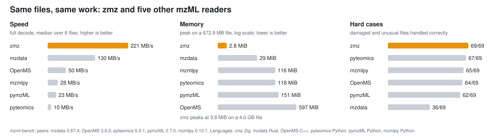

<!-- markdownlint-disable MD033 MD041 -->

<p align="center">
  
</p>

<p align="center">
  Mass Spectrometry Open Data Format Library for Zig
</p>

<p align="center">
  <a href="https://github.com/eneskemalergin/zmz/actions/workflows/ci.yml"></a>
  <a href="https://github.com/eneskemalergin/zmz/releases/latest"></a>
  <a href="https://ziglang.org/download/"></a>
  <a href="#status-and-limits"></a>
  <a href="#license"></a>
</p>

<p align="center">
  <a href="#install">Install</a> | <a href="#example">Example</a> | <a href="#documentation">Documentation</a> | <a href="#benchmarks">Benchmarks</a> | <a href="#built-with-zmz">Built with zmz</a> | <a href="#status-and-limits">Status</a>
</p>

<!-- markdownlint-enable MD041 -->

---

zmz reads and writes mass-spectrometry data in Zig, starting with mzML. It streams files of any size in flat memory, looks records up through their index, decodes and encodes binary arrays, and writes plain or indexed mzML. I built it as the mzML layer for my own Zig tools; it takes its model ideas from [mzdata](https://github.com/mobiusklein/mzdata), a Rust library for the same formats.

- **Reading:** forward streaming, with or without array decoding; `Events` for every XML event with its source offsets; indexed lookup by ID or position through an embedded or rebuilt index.
- **Writing:** plain and indexed mzML, from records you read, edited, or built.
- **Arrays:** 32- and 64-bit floats and integers; zlib; MS-Numpress Linear, PIC, and SLOF, alone or with zlib.
- **Metadata:** every parameter kept as written, scientific fields (MS level, scan time, precursors), and optional PSI-MS and Unit Ontology lookup, bundled or loaded from a newer OBO release.
- **Files:** mzML 1.1 and the original 1.0, in UTF-8, UTF-16, or ISO-8859-1.

## Install

zmz needs Zig 0.16.0 and nothing else; zlib comes from [zipir](https://github.com/eneskemalergin/zipir), fetched by hash.

```sh
zig fetch --save git+https://github.com/eneskemalergin/zmz#v0.1.0
```

Then import the module in `build.zig`:

```zig
const zmz = b.dependency("zmz", .{ .target = target, .optimize = optimize });
executable.root_module.addImport("zmz", zmz.module("zmz"));
```

## Example

This program prints each record's ID, MS level, and number of decoded arrays:

```zig
const std = @import("std");
const mzml = @import("zmz").mzml;

pub fn main(init: std.process.Init) !void {
    const args = try init.minimal.args.toSlice(init.arena.allocator());
    const file = try std.Io.Dir.cwd().openFile(init.io, args[1], .{});
    defer file.close(init.io);
    var buffer: [64 * 1024]u8 = undefined;
    var input = file.reader(init.io, &buffer);

    var reader = try mzml.StreamReader.init(init.gpa, &input.interface, .{});
    defer reader.deinit();
    const header = try reader.readHeader();
    var arrays = mzml.DecodedArrays.init(init.gpa, .{});
    defer arrays.deinit();

    while (try reader.nextDecodedRecord(&arrays)) |record| {
        const level = if (record.node.kind == .spectrum) try record.msLevel(header.groups) else null;
        std.debug.print("{s} ms_level={?d} arrays={d}\n", .{ record.id, level, arrays.len() });
    }
}
```

## Documentation

[The wiki](https://github.com/eneskemalergin/zmz/wiki) explains each part in depth: getting started, reading, writing, indexed access, binary arrays, vocabulary, errors and diagnostics, limits and safety, performance, benchmarks, and development.

In this repository:

- [Examples](examples/README.md): complete programs for streamed reading, selected decoding, indexed access, building arrays, and rewriting files, each with its cleanup and lifetime rules.
- [Vocabulary](vocabularies/README.md): the bundled PSI-MS and Unit Ontology tables, lookup, release history, and how they are updated.

## Benchmarks

<p align="center">
  <picture>
    <source media="(prefers-color-scheme: dark)" srcset="assets/benchmark-summary-dark.svg">
    
  </picture>
</p>

Six mzML libraries read the same real files through their own public APIs. Every value they return is first checked against an independent reference reader, and a library is timed only on files where it did the same work.

| Library           | Language    | Full decode | Peak memory | Hard cases |
| ----------------- | ----------- | ----------: | ----------: | ---------: |
| **zmz**           | Zig         |    221 MB/s |     2.8 MiB |      69/69 |
| mzdata            | Rust        |    130 MB/s |      29 MiB |      36/69 |
| OpenMS (pyopenms) | C++, Python |     50 MB/s |     597 MiB |      64/69 |
| mzmlpy            | Python      |     28 MB/s |     116 MiB |      65/69 |
| pymzML            | Python      |     23 MB/s |     151 MiB |      62/69 |
| pyteomics         | Python      |     10 MB/s |     118 MiB |      67/69 |

- Full decode is the median over files from 15 MB to 4 GB (673 MB for the Python libraries); peak memory is on a 673 MB file. On a 4 GB file, zmz peaks at 3.8 MiB.
- Hard cases are damaged files (cut, stale or missing index) and unusual but valid mzML (encodings, CDATA, comments, number spellings).
- [Benchmarks](https://github.com/eneskemalergin/zmz/wiki/Benchmarks) in the wiki has the method, machine, versions, per-file numbers, and what each library got wrong.

`zig build bench` measures zmz on its own, with nothing to download: forward reading, full decoding, XML events, indexed lookup, copying, and writing, on generated files in five shapes.

## Built with zmz

<p align="center">
  <a href="https://github.com/eneskemalergin/mzValidate"></a>
  &nbsp;
  <a href="https://github.com/eneskemalergin/mzarc"></a>
</p>

- **[mzValidate](https://github.com/eneskemalergin/mzValidate)** validates mzML files in one streaming pass, on zmz's XML events, Base64, zlib, and SHA-1.
- **[mzarc](https://github.com/eneskemalergin/mzarc)** compresses mass-spectrometry spectra with domain-specific codecs, decoding only the arrays it archives.

Both move to zmz in their next releases. [Built with zmz](https://github.com/eneskemalergin/zmz/wiki/Built-with-zmz) says what each one uses; open an issue to add yours.

## Status and limits

zmz is in early development. Until 1.0 the API can change between versions. CI runs the tests on x86_64 and aarch64 Linux and on aarch64 macOS; big-endian targets are refused at build time.

Not supported yet:

- formats other than mzML;
- whole-file gzip (planned for 0.2.0) and Zstandard-compressed arrays;
- pre-release mzML drafts (0.93 and 0.99), which use their own namespaces.

zmz checks what it needs to read and write correctly. Validating a file against the mzML schema and its vocabulary rules is [mzValidate](https://github.com/eneskemalergin/mzValidate)'s job.

## Development

- `zig build test --summary all`: every test; add `-Doptimize=ReleaseFast` for release builds.
- `zig build examples`: builds the example programs; `zig build test-examples` runs them on small fixtures.
- `zig build bench`: the benchmark above.
- `zig build check-mzml -- FILE.mzML ...`: reads, decodes, and index-checks real files, then prints totals.
- `zig build vocabulary -- ...` and `zig build libm-data -- ...`: maintain the generated vocabulary and SLOF tables.

CPU-specific code (AVX2 Base64, SHA-1 extensions, an x86-64-v3 zlib decoder) is chosen at run time; `-Dkernel-backend=portable` leaves it out. Builds target the baseline CPU unless you pass `-Dcpu=native`.

## Contributing

Contributions are welcome; [CONTRIBUTING.md](CONTRIBUTING.md) says what a change needs before it is merged. Report security problems privately, as [SECURITY.md](SECURITY.md) describes. [CHANGELOG.md](CHANGELOG.md) lists what each version changes, and [CITATION.cff](CITATION.cff) says how to cite zmz.

## License

zmz is licensed under the [Apache License, Version 2.0](LICENSE). [`NOTICE`](NOTICE) carries the third-party notices: zipir and Arm's `exp` and `log` tables (both MIT), and the bundled PSI-MS and Unit Ontology tables (Creative Commons Attribution 4.0). The logo and icons adapt the Zig logo and are licensed CC BY-SA 4.0. Include `LICENSE` and `NOTICE` with source and binary distributions.

---

<p align="center"><sub>Ions fly, then rest<br>as peaks in angle brackets,<br>read in one long pass.</sub></p>
