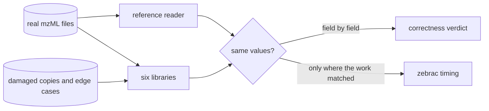

# Benchmarks

Speed numbers are easy to produce and easy to fool yourself with. A reader that skips half the arrays, rounds everything to 32 bits, or stops quietly at a damaged spectrum will look fast. So the comparison here checks correctness first and times second: a library is timed on a file only when it returned the same data as everyone else.

The short version: zmz was the fastest reader on every file, used a few MiB of memory where the others used tens to thousands, and read every file, damaged or unusual, correctly. The rest of this page shows how that was measured and what the other libraries got wrong.

## How it was measured

The comparison comes from mzml-bench, a separate benchmark project that will be published in its own repository. Every library reads the same real mzML files through its own public API, and an independent reference reader (built only on lxml, zlib, and the C++ MS-Numpress reference) says what each file contains.

- **Libraries:** zmz (Zig), mzdata 0.67.4 (Rust), OpenMS 3.6.0 (C++, natively and through pyopenms), pyteomics 5.0.1, pymzML 2.7.0, and mzmlpy 0.10.1 (Python). zmz was a development build from just before 0.1.0.
- **Machine:** AMD Ryzen 9 3950X, Linux 7.2, timed with zebrac on one pinned core, in rotating rounds: three runs after a warm-up for most libraries, five for pyteomics.
- **Task:** full decode, reading every spectrum and chromatogram with every array decoded, counting records and values.
- **When:** October 2026, in one full run. Later runs will update this page.

> [!NOTE]
> Python libraries were timed on files up to 673 MB. The 4 GB file takes them hours per run, and nothing on this page depends on it.

## Speed

Throughput in MB/s of mzML, on the timing files (higher is better):

|   File |     zmz | mzdata | OpenMS C++ | pyopenms | Best Python |
| -----: | ------: | -----: | ---------: | -------: | ----------: |
|  15 MB | **194** |    121 |         38 |       27 |          21 |
|  50 MB | **224** |    142 |         57 |       48 |          31 |
| 162 MB | **228** |    125 |         57 |       50 |          27 |
| 322 MB | **190** |    126 |         64 |       57 |          31 |
| 673 MB | **218** |    134 |         58 |       60 |          28 |
| 4.0 GB | **254** |    175 |         97 |        - |           - |

- "Best Python" is the fastest of pyteomics, pymzML, and mzmlpy on that file; it was mzmlpy every time.
- Across these files, mzdata took 1.6 times as long as zmz, pyopenms 4.5 times, and the Python readers 7.7 to 23 times.
- Per decoded value, zmz retired about 540 instructions, mzdata 720, pyopenms 1,600, and the Python readers 3,300 to 8,500.

I'm proud of the 4 GB row: zmz read the whole file in 15.9 seconds. mzdata took 23.1 seconds, and OpenMS 41.6 natively and 44.8 in its streaming mode.

## Memory

Peak resident memory for the whole process, on the same files (lower is better):

|   File |         zmz |  mzdata | OpenMS C++ | OpenMS streaming | pyopenms | Python range   |
| -----: | ----------: | ------: | ---------: | ---------------: | -------: | -------------- |
|  15 MB | **1.3 MiB** | 5.0 MiB |     64 MiB |           55 MiB |  105 MiB | 43 to 103 MiB  |
|  50 MB | **1.3 MiB** | 5.8 MiB |     98 MiB |           55 MiB |  142 MiB | 46 to 104 MiB  |
| 162 MB | **1.8 MiB** |  11 MiB |    167 MiB |           56 MiB |  212 MiB | 62 to 107 MiB  |
| 322 MB | **2.0 MiB** |  14 MiB |    349 MiB |           57 MiB |  394 MiB | 69 to 108 MiB  |
| 673 MB | **2.8 MiB** |  29 MiB |    548 MiB |           57 MiB |  597 MiB | 116 to 151 MiB |
| 4.0 GB | **3.8 MiB** |  49 MiB |    5.1 GiB |           73 MiB |        - | -              |

zmz's peak barely moves as files grow: from 15 MB to 4 GB, more than 260 times the size, it went from 1.3 to 3.8 MiB. That's the [streaming design](Performance) doing its job. OpenMS's default reader loads the whole run, which is why it needs 5.1 GiB for the 4 GB file; its streaming mode stays near 60 MiB.

## Correctness

Each library read 22 files, and every field it returned (IDs, MS level, polarity, spectrum type, retention time, precursors, and every array value) was compared with the reference reader. Each file gets the library's worst verdict:

| Library   | Exact | Equivalent | Rounded | Partial | Lossy | Wrong | Crash |
| --------- | ----: | ---------: | ------: | ------: | ----: | ----: | ----: |
| zmz       |    22 |          0 |       0 |       0 |     0 |     0 |     0 |
| mzmlpy    |    22 |          0 |       0 |       0 |     0 |     0 |     0 |
| pyteomics |    21 |          1 |       0 |       0 |     0 |     0 |     0 |
| pyopenms  |     2 |         13 |       5 |       0 |     2 |     0 |     0 |
| pymzML    |    14 |          1 |       0 |       6 |     0 |     0 |     1 |
| mzdata    |     4 |          0 |       9 |       0 |     1 |     4 |     4 |

What the verdicts mean:

- **Exact:** every field and array equal to the reference.
- **Equivalent:** equal after a unit conversion, peak reordering, or an omitted empty array.
- **Rounded:** values kept at 32-bit precision; at most about 0.06 ppm off.
- **Partial:** some fields the library's API cannot return.
- **Lossy:** a value the file does not declare was invented, or an ID or summary rewritten.
- **Wrong:** a differing value, or missing or extra records, without an error.
- **Crash:** the library panicked or raised.

> [!IMPORTANT]
> "Wrong" is the verdict that matters most: the program gets different data and no error. zmz has none, by design: it [never guesses](Getting-started#your-first-program), and it refuses what it cannot read.

## Damaged and unusual files

Two sets of hard cases:

- **Five damaged copies** of a public file: the index and checksum cut off, a stale index offset, the index removed, the file cut between spectra, and cut inside a binary array. A correct reader reads the complete ones and reports an error on the cut ones.
- **74 edge cases:** small variants of one valid document that change one thing the XML or mzML specifications leave free (UTF-16, ISO-8859-1, CDATA, comments, Base64 line breaks, number spellings, namespace prefixes, empty-element syntax), plus malformed documents that must be refused. 64 have a scored answer.

| Library   | Damaged files | Edge cases | Mishandled |
| --------- | ------------: | ---------: | ---------: |
| zmz       |           5/5 |      64/64 |          0 |
| pyteomics |           4/5 |      63/64 |          1 |
| mzmlpy    |           5/5 |      60/64 |          4 |
| pyopenms  |           4/5 |      60/64 |          3 |
| pymzML    |           4/5 |      58/64 |          6 |
| mzdata    |           0/5 |      36/64 |         28 |

mzdata's 0/5 deserves a sentence: a file cut off mid-run reads as a shorter, complete file, with no error and exit status 0. That is exactly the silent failure this benchmark exists to catch.

## Writing

Three libraries can write mzML. Each rewrote the 22 files, plain and with zlib, and the output was read back by the reference reader, validated against the mzML schema and OpenMS's semantic rules, and its index and checksum checked:

| Writer         | Exact | Equivalent | Rounded | Partial | Lossy | Wrong | Crash or refused |
| -------------- | ----: | ---------: | ------: | ------: | ----: | ----: | ---------------: |
| zmz            |    22 |          0 |       0 |       0 |     0 |     0 |                0 |
| zmz, zlib      |    22 |          0 |       0 |       0 |     0 |     0 |                0 |
| pyopenms       |     1 |         14 |       4 |       1 |     2 |     0 |                0 |
| pyopenms, zlib |     1 |         14 |       4 |       1 |     2 |     0 |                0 |
| mzdata         |     0 |          0 |       0 |       0 |    15 |     1 |                6 |
| mzdata, zlib   |     0 |          0 |       0 |       0 |    15 |     1 |                6 |

zmz's rewrites read back identical to the source on every file, valid and with a correct index.

## What turned up

Every result short of exact was traced to a cause, with a minimal reproduction, ready to report upstream. A few that are worth knowing if you use these libraries:

- **mzdata:** a read error ends iteration as if the file had ended, and is only logged; a file cut off mid-run reads as complete.
- **OpenMS:** intensities are held as 32-bit floats, and absent isolation offsets read back as 0.0.
- **pymzML:** every MS-Numpress array raises an `AttributeError`.
- **pyteomics:** a charge state of 0 comes back as `None`.

zmz was not exempt. The benchmark found three of its own bugs (an `us-ascii` declaration refused, one malformed selected-ion field losing the ion's other fields, and the rewrite example trusting a wrong declared count), and all three were fixed before these numbers were taken.

## Run it yourself

`zig build bench` measures zmz alone on generated files, with nothing to download: forward reading, full decoding, XML events, indexed lookup, copying, and writing, each in its own process. It prints wall time, throughput, peak memory, and a checksum of what each case read. See [Performance](Performance#measuring).

The comparison above needs the other libraries and the real files; mzml-bench's own repository will have the setup, the corpus list with checksums, and the full report, and this page will link to it.
