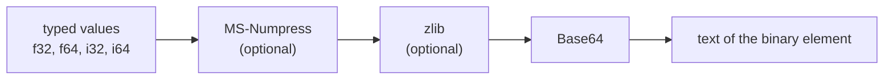

# Binary arrays

The numbers in an mzML file, the m/z and intensity values that are the whole point of the file, are stored as Base64 text inside `<binary>` elements. This page explains the encodings, what zmz does with each, and how to use the codecs directly.

## The pipeline

Every array goes through the same steps, some of them optional:



Decoding runs it backwards. Two `cvParam`s on the array say which steps were used: one data type and one compression term.

Data types:

| Accession | Name | zmz type |
|---|---|---|
| `MS:1000521` | 32-bit float | `f32` |
| `MS:1000523` | 64-bit float | `f64` |
| `MS:1000519` | 32-bit integer | `i32` |
| `MS:1000522` | 64-bit integer | `i64` |

Compression:

| Accession | Pipeline | Lossy |
|---|---|---|
| `MS:1000576` | `.none` | no |
| `MS:1000574` | `.zlib` | no |
| `MS:1002312` | `.linear` | yes |
| `MS:1002313` | `.pic` | yes |
| `MS:1002314` | `.slof` | yes |
| `MS:1002746` | `.linear_zlib` | yes |
| `MS:1002747` | `.pic_zlib` | yes |
| `MS:1002748` | `.slof_zlib` | yes |

- Primitive bytes are little-endian, and float bits are kept exactly: a `NaN` payload survives a round trip.
- Every MS-Numpress array decodes to `f64`. Set `DecodedArrays.Options.numpress_precision = .declared` to get `f32` back for arrays declared as 32-bit floats.
- A term repeated through a parameter group must agree with the array's own, or the read fails with `ConflictingPrimitive` or `ConflictingCompression`. A missing one is `MissingPrimitive` or `MissingCompression`.

> [!WARNING]
> Some encodings exist in the vocabulary that zmz does not implement: 16-bit floats, null-terminated text, Zstandard, byte shuffling, truncation, and coordinate grids. They fail with `UnsupportedEncoding` instead of being decoded as something they are not. Reading such an array's metadata, skipping it with a selector, or copying its text unchanged still works.

## MS-Numpress

[MS-Numpress](https://github.com/ms-numpress/ms-numpress) is a family of three lossy transforms that make mass-spec arrays compress far better, at a precision cost you choose. zmz's encoder writes the same bytes as the C++ reference wherever the reference's input is valid.

All three end in the same integer code: each integer is written as a variable number of half-bytes, so small numbers take one or two half-bytes instead of four bytes.

### Linear prediction

For sorted, evenly growing values like m/z. Each value is scaled by a **fixed point** $f$ and rounded:

$$x_i = \left\lfloor v_i f + \tfrac{1}{2} \right\rfloor$$

The first two are stored as they are. Every later value is predicted from the two before it, and only the residual is stored:

$$r_i = x_i - \left(2x_{i-1} - x_{i-2}\right)$$

For an m/z array the prediction is almost right, so the residuals are tiny, and the half-byte code stores most of them in a byte or less. Decoding reverses it exactly, so the only loss is the first rounding:

$$\left| \hat v_i - v_i \right| \le \frac{1}{2f}$$

The largest $f$ that keeps every residual in 32 bits gives the best precision; `numpress.optimalLinearFixedPoint` computes it, as the reference does. To ask for a precision instead, `linearFixedPointForAbsoluteError(values, max_abs_error)` returns $f = 1/(2\varepsilon)$, or `ToleranceUnattainable` when that does not fit.

### Positive integer compression (PIC)

For counts, like ion intensities from a counting detector. Each value is rounded to the nearest integer and written with the half-byte code; no fixed point is involved. Values must lie in $[0, 2^{32}-1]$. Integer input comes back exactly.

### Short logged float (SLOF)

For intensities, where relative precision matters and absolute precision does not. Each value is stored in 16 bits on a log scale:

$$x_i = \mathrm{round}\big(f \ln(1+v_i)\big), \qquad \hat v_i = e^{x_i / f} - 1$$

Since $x_i$ is off by at most a half, the error is relative:

$$\left| \ln\frac{1+\hat v_i}{1+v_i} \right| \le \frac{1}{2f}$$

`numpress.optimalSlofFixedPoint` picks $f = \lfloor 65535 / \max_i \ln(1+v_i) \rfloor$, the largest $f$ for which every code fits in 16 bits.

> [!NOTE]
> SLOF depends on `exp` and `log`, and different math libraries round them differently in the last bit, which changes a code now and then. zmz computes them exactly as glibc does, so its SLOF bytes and values match C++ ms-numpress and numpress-rs on Linux. glibc itself has two forms, with and without fused multiply-add, which disagree on a small fraction of inputs; zmz uses the fused form when the build target has FMA (x86-64-v3, aarch64) and the plain form otherwise, so a baseline x86-64 build matches glibc's plain form, and `-Dcpu=native` on an FMA machine matches the fused one.

## Using the codecs directly

Readers decode for you, but the codecs are public too: `mzml.arrays` for whole pipelines, plus `numpress`, `base64`, `zlib`, and `sha1` on their own. This encodes four m/z values with Linear prediction and zlib, decodes them, and checks the bound above:

```zig
fn roundTrip(allocator: std.mem.Allocator) !void {
    const values = [_]f64{ 400.1234, 400.2468, 400.3702, 401.0 };
    const fixed_point = try mzml.numpress.optimalLinearFixedPoint(&values);

    var encoder = mzml.arrays.Encoder.init(allocator, .fast);
    defer encoder.deinit();
    const wire = try encoder.encode(f64, &values, .{ .pipeline = .linear_zlib, .fixed_point = fixed_point });

    var decoded: [values.len]f64 = undefined;
    var transformed: [64]u8 = undefined;
    try mzml.arrays.decodeWire(f64, &decoded, wire, .linear_zlib, &transformed);
    for (values, decoded) |before, after| std.debug.assert(@abs(before - after) <= 0.5 / fixed_point);
}
```

- **"Wire" bytes** are everything before Base64. `arrays.encode` and `arrays.decode` include the Base64 step; `encodeWire` and `decodeWire` stop before it.
- **Only `arrays.Encoder` allocates.** It owns the zlib compressor and one output buffer per encoded array until its `reset`. Every other function works in buffers you pass, and refuses overlapping ones with `OverlappingBuffers`.
- **zlib presets** are `.fast`, `.even`, and `.dense`, from fastest to smallest. Compressed bytes can differ between zlib implementations and versions; they always decode to the same values.
- **Streaming.** `DecodedArrays` decodes text as it arrives, and `numpress.Decoder` takes a payload in fragments of any size, giving the same values and errors for every split.

## How fast

Base64 decodes with AVX2, zlib inflates with a decoder built for x86-64-v3, and both are picked at run time on CPUs that have them, with portable code everywhere else. [Performance](Performance) explains how that works and how to turn it off.
