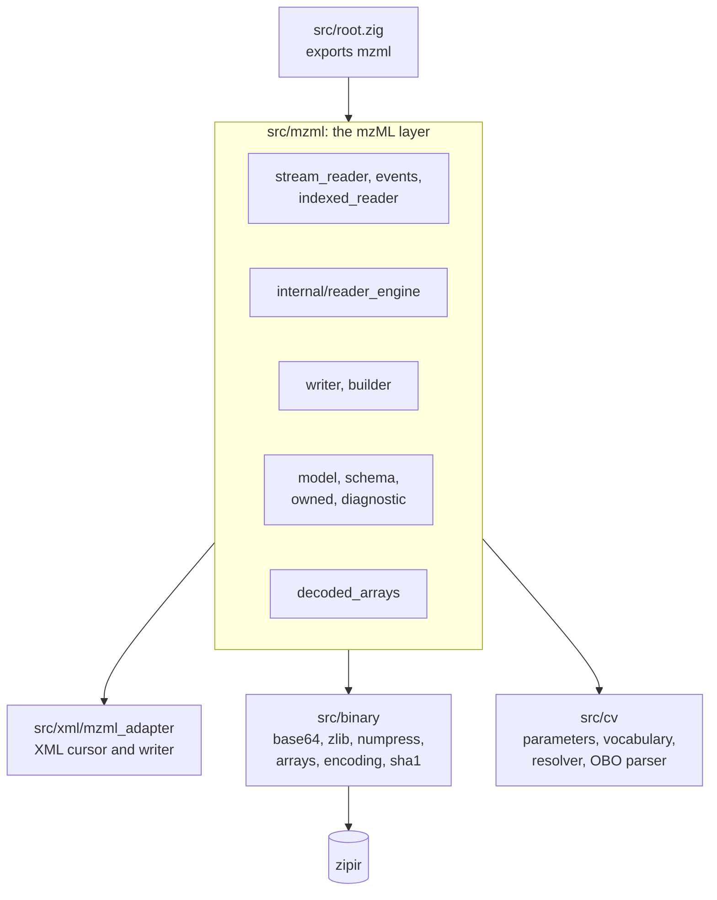

# Development

How the repository is laid out, how to build and test it, and the tools that come with it. If you want to contribute, [CONTRIBUTING.md](https://github.com/eneskemalergin/zmz/blob/main/CONTRIBUTING.md) says what a change needs; this page is the map.

## Build steps

All you need is Zig 0.16.0. zipir, the only dependency, is fetched by hash on the first build.

- `zig build test --summary all`: every test: library, examples, tools, and benchmark. Add `-Doptimize=ReleaseFast` for release builds.
- `zig build examples`: builds the five [example programs](https://github.com/eneskemalergin/zmz/blob/main/examples/README.md) into `zig-out/bin/`. `zig build test-examples` runs them on small fixtures.
- `zig build bench`: the [benchmark](Performance#measuring).
- `zig build check-mzml -- FILE.mzML ...`: reads real files end to end (see below).
- `zig build vocabulary -- ...`: maintains the bundled vocabulary tables; see the [vocabulary README](https://github.com/eneskemalergin/zmz/blob/main/vocabularies/README.md#offline-updates).
- `zig build libm-data -- MUSL_MATH_DIR OUTPUT.zig`: regenerates the `exp` and `log` tables SLOF uses, from a musl source tree.

Build options:

- `-Dkernel-backend=portable` leaves out every CPU-specific code path; `dispatch`, the default, picks them at run time.
- `-Dcpu=native` builds for your CPU instead of the baseline.

## Where things live



- **`src/xml`** reads and writes XML: well-formedness, encodings, namespaces, and the limits that keep it bounded. It knows nothing about mzML beyond element names.
- **`src/binary`** has the codecs. Nothing in it allocates except the zlib state and `arrays.Encoder`.
- **`src/cv`** has parameters as written (`source.zig`), the vocabulary tables and their generated data, the OBO parser, and the resolver.
- **`src/mzml`** builds the format on top: the model, the readers sharing one engine, the writer, and the builder.
- **`tests/`** holds tests of public behavior, one suite per area, with small fixtures under `tests/mzml/data`. Tests never read files outside the repository.
- **`examples/`**, **`tools/`**, and **`bench/`** are programs built with the library and tested with it.
- **`vocabularies/`** records where the bundled tables came from: manifest, release history, and the update procedure.

## Checking real files

The tests use small fixtures on purpose. Real instrument files are where the surprises are, so `check-mzml` reads them:

```sh
zig build check-mzml -Doptimize=ReleaseFast -- run1.mzML run2.mzML
```

For each file it rebuilds the index, streams every record, reads its metadata, decodes its arrays, and compares the first, middle, and last records with their indexed lookups, then prints the totals. A malformed selected-ion or isolation-window field is counted and the check moves on; any other failure stops that file with its diagnostic and exits with status 1.

> [!TIP]
> Got a file that zmz reads wrong, or refuses? That is the most useful bug report there is. Run `check-mzml` on it and attach the output to an issue; even without the file, the diagnostic usually says enough to start.

## Continuous integration

- **Pushes to `main` and pull requests:** format check and the full test suite in Debug on x86_64 and aarch64 Linux, plus a `CITATION.cff` check.
- **Pull requests to `main`:** the release gate adds ReleaseFast on x86_64 Linux (once with CPU-specific code and once without), ReleaseFast on aarch64 Linux, and Debug on aarch64 macOS.
- **Weekly:** the vocabulary workflow checks for new PSI-MS and Unit Ontology releases and opens a pull request when there is one.
- **Workflow changes:** actionlint and zizmor check the workflow files themselves.
- **Changes to `wiki/` on `main`:** published to this wiki from `main`'s head, so the wiki always matches `main`.
- **Version tags (`vX.Y.Z`):** nothing runs unless the tag matches the version in `build.zig.zon` and a dated `CHANGELOG.md` entry, sits on `main`, and `main`'s CI passed on that commit. Then the release gate runs again on the tagged commit, and the source archive is built from the package's `.paths` and used as a fresh dependency. Only when both pass is the release published, with the changelog entry as its notes, plus the archive, its SHA-256, and a build attestation. A release runs only from a tag push, or by hand with the tag as its ref.

## Style

The code is ordinary Zig: `zig fmt`, explicit allocators, error unions. A few conventions recur:

- Comments say why, in the format's terms: the invariant, the specification rule, the cost.
- Tests are named `[type] - [target]: behavior`, such as `[failure] - [mzML reader]: rejects an unterminated binary element`.
- Everything that grows with input has a limit.

None of this is a gate for contributions; follow what is convenient.
