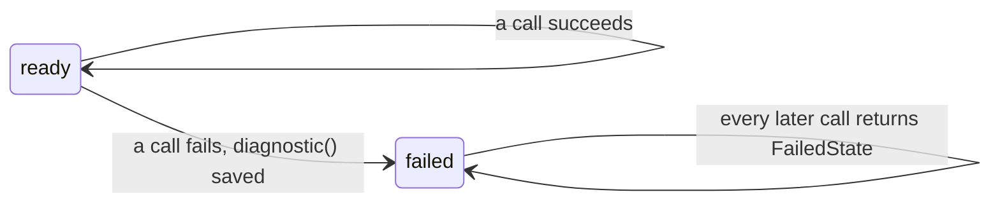

# Errors and diagnostics

zmz fails loudly and specifically. Every failure is a named Zig error you can `switch` on, and the reader, writer, or index that failed keeps a `Diagnostic` saying where it happened. I wanted the error from a 40 GB file to tell you which spectrum and which byte, not just `InvalidXml`.

## Errors drive control flow

zmz functions return ordinary error unions. Handle them the Zig way:

```zig
const level = record.msLevel(header.groups) catch |err| switch (err) {
    error.RepeatedParameter, error.InvalidValue => null, // this file's problem: skip the field
    else => return err,
};
```

The error sets are precise, so the compiler tells you what each call can return. The names say whose problem it is:

- **The file:** `InvalidXml`, `MissingAttribute`, `InvalidIndex`, `DecodedSizeMismatch`, `UnsupportedEncoding`.
- **Your buffers:** `OutputTooSmall`, `OverlappingBuffers`.
- **Your options or arguments:** `InvalidOptions`, `MissingFixedPoint`, `InvalidFixedPoint`.
- **The order of your calls:** `InvalidState`.
- **A limit:** `LimitExceeded`, everywhere.

The error is also deterministic: however the input arrives, in one read or a byte at a time, the same file gives the same values and the same error.

## Diagnostics say where

The error name says what; the diagnostic says where. Ask the object that failed:

```zig
fn readReporting(allocator: std.mem.Allocator, input: *std.Io.Reader, path: []const u8) !usize {
    var reader = try mzml.StreamReader.init(allocator, input, .{});
    defer reader.deinit();
    errdefer if (reader.diagnostic()) |report| std.debug.print("{s}: {f}\n", .{ path, report });

    _ = try reader.readHeader();
    var records: usize = 0;
    while (try reader.nextRecord()) |_| records += 1;
    return records;
}
```

On a file cut off in the middle of its first spectrum, this prints:

```text
broken.mzML: [ZMZ0011] read_record: XML cannot be processed (InvalidXml); stage=xml; input_event=128; element=spectrum; spectrum_ordinal=0; xml_rule=unexpected_end
```

Reading it left to right:

- **`ZMZ0011`**: a stable ID for the kind of failure. IDs are never reused, so you can match on them in logs and scripts.
- **`read_record`**: the operation that failed.
- **`InvalidXml`**: the Zig error that was returned.
- **`stage=xml`**: the layer that failed: `xml`, `metadata`, `base64`, `array`, `index`, or `output`.
- **`input_event=128`**: a byte offset in the source, counting source bytes even for UTF-16. For malformed XML it is the first byte of what broke the rule; for other failures, the start of the XML event being read. Writers report `output_byte`, the count of output bytes accepted so far.
- **`element`, `spectrum_ordinal`**: which element, and which record counted from zero.
- **`xml_rule=unexpected_end`**: the detail, here the XML rule that was broken. Other failures name an `attribute`, a `limit` with its maximum and what was needed, or an expected and actual `size`.

A field zmz does not know is left out (null), never reported as zero. A `Diagnostic` is a plain value with no pointers into the reader, so you can keep it after `deinit`, store it, or format it later. `{f}` formats it without allocating.

Each of these has a `diagnostic()`:

- `StreamReader`, `Events`, `Writer`
- `IndexedReader` for lookups; for opening, `IndexedReader.buildWithDiagnostic` fills one in, since there is no reader yet when opening fails
- `DecodedArrays`, for `decodeRecord`, `decodeArray`, and `decodeArrayText`

## Failures are sticky



After its first failure, a `StreamReader`, `Events`, or `Writer` returns `FailedState` from every later call, and `diagnostic()` keeps the first failure. A stream that failed halfway through a record is in no state to continue, and pretending otherwise is how a reader silently skips data. To read past a bad record, open the file again, or look the next record up through an [index](Indexed-access); an `IndexedReader` lookup failure does not stop later lookups.

## The IDs

| ID | Name |
|---|---|
| ZMZ0001 | `out_of_memory` |
| ZMZ0002 | `limit_exceeded` |
| ZMZ0003 | `xml_encoding_unavailable` |
| ZMZ0004 | `array_encoding_unavailable` |
| ZMZ0005 | `missing_attribute` |
| ZMZ0006 | `invalid_base64` |
| ZMZ0007 | `decoded_size_mismatch` |
| ZMZ0008 | `invalid_index` |
| ZMZ0009 | `write_failed` |
| ZMZ0010 | `array_decode_failed` |
| ZMZ0011 | `invalid_xml` |
| ZMZ0012 | `invalid_structure` |
| ZMZ0013 | `invalid_value` |
| ZMZ0014 | `invalid_state` |
| ZMZ0015 | `invalid_options` |
| ZMZ0016 | `size_overflow` |
| ZMZ0017 | `buffer_error` |
| ZMZ0018 | `missing_payload` |
| ZMZ0019 | `group_error` |
| ZMZ0020 | `array_declaration_error` |
| ZMZ0021 | `missing_index` |
| ZMZ0022 | `duplicate_id` |
| ZMZ0023 | `ambiguous_id` |
| ZMZ0024 | `source_changed` |
| ZMZ0025 | `unsupported_source` |
| ZMZ0026 | `truncated_source` |
| ZMZ0027 | `io_failed` |
| ZMZ0028 | `canceled` |
| ZMZ0029 | `count_mismatch` |

- `Diagnostic.Id.description()` gives each one's sentence, as the formatted report shows it.
- ZMZ0030 is intentionally unused. New IDs are added at the end.

## Common failures and what they mean

- **`LimitExceeded` (ZMZ0002)**: the input needs more than a configured limit allows. The diagnostic names the limit, its maximum, and often what was needed. Raise that one limit if the file is legitimate; see [Limits and safety](Limits-and-safety).
- **`UnsupportedEncoding` (ZMZ0003 or ZMZ0004)**: a character encoding zmz does not read (such as UTF-32), or an array encoding it does not implement; see [Binary arrays](Binary-arrays).
- **`MissingValue` on decoding**: an array has neither its own `arrayLength` nor the record's `defaultArrayLength`, so zmz cannot know how many values to expect.
- **`CountMismatch` (ZMZ0029)**: a list's declared count disagrees with the records written. Readers never fail on this; writers do, because the count they wrote up front would be wrong.
- **`InvalidState` (ZMZ0014)**: a call out of order, such as `beginList` before `writeHeader`, or a call back into a reader from its own callback.
- **`StaleSource` (ZMZ0024)**: the file under an `IndexedReader` changed.
