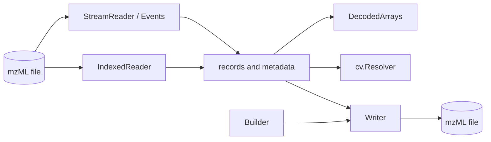

# zmz

zmz is a Zig library for mass-spectrometry data, starting with mzML. It reads files of any size in flat memory, finds records through their index, decodes and encodes the standard binary-array encodings, writes plain or indexed mzML, and looks terms up in the PSI-MS and Unit Ontology vocabularies. It needs Zig 0.16.0 and nothing else.

I wrote it because I kept needing the same mzML layer in my own Zig tools, and I wanted that layer to be fast, small, and honest about what it does not know. This wiki is where the details live; the [README](https://github.com/eneskemalergin/zmz#readme) stays short.

## Start here

- [Getting started](Getting-started): install zmz and read your first file.
- [mzML in brief](mzML-in-brief): how an mzML file is put together, and the words this wiki uses for its parts.

## Using zmz

- [Reading](Reading): forward reading, decoding while reading, choosing what to decode, copying, and raw XML events.
- [Ownership and lifetimes](Ownership-and-lifetimes): what borrows from what, and for how long. Read this one early.
- [Indexed access](Indexed-access): fetching records by ID or position.
- [Writing](Writing): plain, indexed, and file output, building records, and rewriting files.
- [Binary arrays](Binary-arrays): primitives, zlib, MS-Numpress, and Base64, including the math behind Numpress.
- [Metadata and parameters](Metadata-and-parameters): parameters, groups, and the scientific fields.
- [Vocabulary](Vocabulary): resolving terms, units, and versions against PSI-MS and the Unit Ontology.

## When things go wrong

- [Errors and diagnostics](Errors-and-diagnostics): named errors and the saved report that says where.
- [Limits and safety](Limits-and-safety): what bounds memory and work on untrusted input.
- [Versions and compatibility](Versions-and-compatibility): which mzML versions, encodings, and platforms zmz reads and runs on.

## Under the hood

- [Performance](Performance): what makes zmz fast, how to measure it, and what to expect.
- [Development](Development): building, testing, the source layout, and the tools in the repository.
