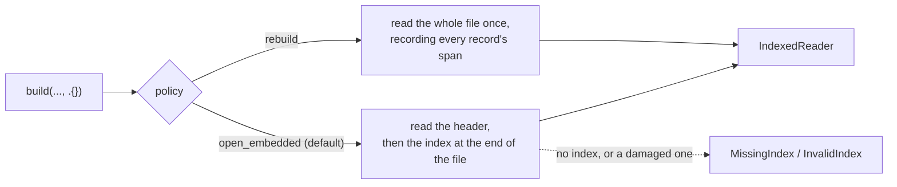

# Indexed access

Streaming is great until you want spectrum `scan=48213` and nothing else. `IndexedReader` keeps a compact table of where every record starts and ends, then reads just that byte range on request.

## Opening an index

```zig
fn lookUp(allocator: std.mem.Allocator, io: std.Io, path: []const u8, id: []const u8) !void {
    const file = try std.Io.Dir.cwd().openFile(io, path, .{});
    defer file.close(io);
    var index = try mzml.IndexedReader.build(allocator, .{ .file = .{ .handle = file, .io = io } }, .{});
    defer index.deinit();
    std.debug.print("{d} records\n", .{index.entryCount()});

    var arrays = mzml.DecodedArrays.init(allocator, .{});
    defer arrays.deinit();
    if (try index.byIdDecoded(allocator, id, &arrays)) |found| {
        var record = found;
        defer record.deinit();
        std.debug.print("{s}: {d} arrays\n", .{ record.value.id, arrays.len() });
    }
    // Spectra by position: the 0th, 10th, 20th, ...
    var ordinal: usize = 0;
    while (try index.at(allocator, .spectrum, ordinal)) |found| : (ordinal += 10) {
        var record = found;
        defer record.deinit();
    }
}
```

The source is either `.bytes` (a slice you already hold, such as a memory-mapped file) or `.file` (an open regular file, read with positional reads). Both are borrowed until `deinit`.

## Two ways to get an index



- **`.open_embedded`** (the default) reads the header and the `indexList` that indexedmzML appends. It looks for `indexListOffset` in the last `tail_bytes` (64 KiB) of the file, so opening costs about the same for a 100 MB file and a 10 GB one.
- **`.rebuild`** scans the whole file once, without keeping any binary text, and records every record's exact span. Use it for plain mzML, or when you do not trust an embedded index.

> [!IMPORTANT]
> There is no automatic fallback. A missing or broken embedded index is an error, never a silent rescan. Whether a 20-minute rebuild is acceptable is your call, not the library's.

```zig
var index = try mzml.IndexedReader.build(allocator, source, .{ .policy = .rebuild });
```

## Lookups

- `byId(allocator, id)` and `byIdDecoded(allocator, id, &arrays)` find a record by its exact ID.
- `at(allocator, kind, ordinal)` and `atDecoded(...)` take a zero-based position within spectra or within chromatograms.
- `entryCount()` and `entryAt(position)` list the entries, spectra first, with each one's kind, ID, ordinal, and byte span.

Every lookup returns an `owned.Record`, or null when the ID or position does not exist. The record is yours: it outlives later lookups and needs its own `deinit`. Decoded numbers go into the `DecodedArrays` you pass, under the usual [rules](Ownership-and-lifetimes#decoded-numbers).

> [!NOTE]
> The ordinal is the position in the index, not the record's `index` attribute. They usually agree; in a file that numbers its spectra from 1, or skips numbers, they do not.

The array selector you set in `options.reader.array_selector` applies to `byIdDecoded` and `atDecoded`, exactly as in [forward reading](Reading#choosing-what-to-decode). Index building never calls it.

## What is checked

An index is a promise about byte offsets, and files break promises. zmz checks rather than trusts:

- **On opening**, the embedded index must be well-formed: offsets in range and increasing, spectra inside the spectrum list, `indexListOffset` pointing at the index. Duplicate IDs within a kind are `DuplicateId`.
- **On every lookup**, the element at the offset must be the record the index names, with that kind and ID; a stale offset is `InvalidIndex`, not the wrong spectrum.
- **The file must not change.** For `.file` sources, zmz records the size, inode, and modification time when it opens, and checks them again on each lookup: a changed file is `StaleSource`.
- An ID used by both a spectrum and a chromatogram is `AmbiguousId` for `byId`; use `at` with the kind instead.

The SHA-1 `fileChecksum` is read but not verified, because verifying it means reading the whole file, which is what the index exists to avoid. To check it, hash the file yourself with `mzml.sha1`.

## Memory

IDs that are fixed text around an integer, like `controllerType=0 controllerNumber=1 scan=48213`, are stored as a shared pattern plus the number: about 35 bytes a record. Other IDs cost about their length more. With such IDs, four million spectra fit in about 140 MB. `options.records` (4,000,000 by default) and `options.index_bytes` (256 MiB) cap both.

The header is copied once at opening and lives until `deinit` (`index.header()`). With `.open_embedded`, its observed list counts stay zero, since no records were read; `entryCount()` has the numbers.

## Concurrency

A lookup reuses the reader's parsing storage, so one `IndexedReader` serves one thread at a time. For parallel lookups, open one reader per thread over the same file. Opening an embedded index again is cheap; a rebuilt one costs another scan.
