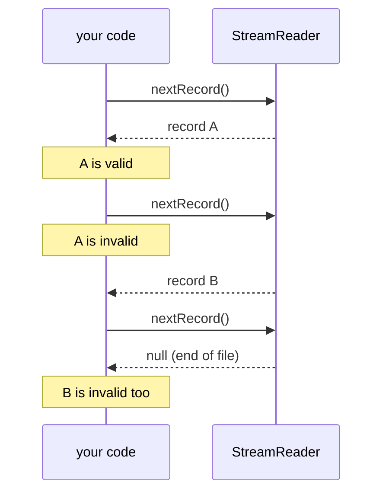

# Ownership and lifetimes

zmz hands you slices into its own buffers instead of copying, which is a big part of why it is fast and small. The price is that every slice has a lifetime, and using one after it ends is a use-after-free. This page lists them all. If you read one page besides [Getting started](Getting-started), make it this one.

Honestly, this is the part that bites. The rules are few and regular, though.

## The rules

- **The header** from `readHeader` lives until the reader's `deinit`.
- **A record** from `nextRecord`, `nextDecodedRecord`, or an item call lives until the next read call on that reader.
- **Numbers in `DecodedArrays`** live until its next decoding read, `reset`, or `deinit`.
- **An event** from `Events.next` lives until the next `next` call.
- **`owned.Record`, `owned.Header`, `owned.Item`** live until their own `deinit`.
- **A record from an `IndexedReader` lookup** is an `owned.Record`: it lives until its `deinit`, whatever the index does next.
- **`Entry.id`** from `entryAt` lives until the next `entryAt` call.
- **A `Diagnostic`** is a plain value. Keep it as long as you like.

"The next read call" includes calls that fail or return null. When a loop ends, the last record is already gone.



## Keeping a record

Copy it into an owned value:

```zig
fn keepFirst(allocator: std.mem.Allocator, reader: *mzml.StreamReader) !?mzml.owned.Record {
    const record = try reader.nextRecord() orelse return null;
    // `record` is valid until the next read; the copy is valid until `deinit`.
    return try mzml.owned.Record.init(allocator, record, .{});
}
```

`owned.Record.init` deep-copies every slice into its own arena; call `deinit` when you are done, and do not copy the owner itself (copy the pointer). A record copy does not include the header's parameter groups, so keep an `owned.Header` too if you will expand groups later. `owned.Item` does the same for items.

> [!TIP]
> Copy only what you need. To remember IDs and MS levels for a whole file, store those two values per record in your own arrays, not an `owned.Record` per spectrum.

## Decoded numbers

`DecodedArrays` owns the numeric buffers and reuses them for every record. Its slices survive ordinary reads (`nextRecord`, `nextItem`) and even the reader's `deinit`, but not its own next decoding read. To keep numbers, copy them:

```zig
fn keepMz(allocator: std.mem.Allocator, reader: *mzml.StreamReader, arrays: *mzml.DecodedArrays) !?[]f64 {
    _ = try reader.nextDecodedRecord(arrays) orelse return null;
    const first = arrays.get(0) orelse return null;
    return switch (first.values) {
        // The copy outlives the next decoded read; `first.values` does not.
        .float64 => |values| try allocator.dupe(f64, values),
        else => null,
    };
}
```

`reset` hides the current arrays and keeps the capacity; a failed read or the end of the file leaves the owner empty. Memory goes back to the allocator only at `deinit`.

## Things that must outlive the reader or writer

- **The input.** `StreamReader` borrows the `std.Io.Reader`; keep it (and its buffer) alive until `deinit`.
- **Selector state.** `user_data` must stay valid while reading and looking up.
- **An `IndexedReader`'s source.** The file must stay open and unchanged; a changed size, inode, or modification time returns `StaleSource`.
- **Prepared arrays.** `Builder.prepareArray` returns a payload that borrows your values and the `arrays.Encoder` until the record is written. Reset the encoder after the record, not between its arrays.
- **Builder output.** Everything a `Builder` built is invalid after its `reset`; the builder refuses arrays from before a reset with `InvalidState` instead of reading freed memory.

## Calling back into zmz

Selection callbacks, your input reader, your allocator, and your writer sink all run inside zmz calls. If one of them calls back into the same reader or writer, the inner call returns `InvalidState` and the running call is unharmed. No reentrancy, by design.

## Allocators

Every zmz type that allocates takes an allocator at `init` and frees everything at `deinit`. Codecs allocate nothing: `arrays.decode`, `base64`, and the Numpress functions work in buffers you pass. Limits bound how much any reader, writer, or builder can retain; see [Limits and safety](Limits-and-safety).
