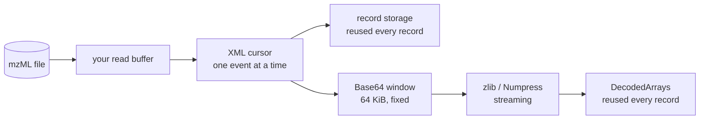

# Performance

zmz is built to read a file at close to the speed the disk delivers it, in memory that does not grow with the file. This page explains where the speed comes from, how to keep it in your own code, and how to measure it.

## Where the time and memory go



- **One pass, one record.** The reader holds the current record and nothing else. Storage for a record is reused for the next, so after the first few records a read loop stops allocating.
- **No copies you did not ask for.** Records borrow from the reader's storage; that is the deal described in [Ownership and lifetimes](Ownership-and-lifetimes).
- **Arrays decode as they stream.** Base64 text goes through a fixed 64 KiB window into zlib or Numpress and straight into the typed output. A 200 MB compressed array never exists in memory as a 200 MB string.
- **Skipping is cheap.** A skipped array's text is scanned to find its end and nothing else: no Base64, no zlib, no storage.

The result is that peak memory follows the largest record, not the file. In the bundled benchmark, every case stays near 1 to 2 MiB of peak memory, and the inputs four times larger stay there too.

## CPU-specific code

Three hot paths have faster versions for newer CPUs:

- **Base64 decoding** uses AVX2 on x86-64.
- **SHA-1**, for indexed output's checksum, uses the x86 SHA extensions.
- **zlib decoding** uses a decoder built for x86-64-v3, from [zipir](https://github.com/eneskemalergin/zipir).

zmz builds for the baseline CPU by default and picks these at run time, once, after checking the CPU's features and that the operating system enables them. So one binary runs everywhere and is fast where it can be. Every path produces identical results; CI runs the tests on both.

- `-Dkernel-backend=portable` leaves CPU-specific code out entirely.
- `-Dcpu=native` builds the whole program for your CPU, which lets the compiler vectorize the rest too.

> [!IMPORTANT]
> Measure in ReleaseFast. A Debug build is many times slower: it runs every safety check and none of the optimizations.

## Fast code in your own program

Most of the speed is in the library, but a few choices in your loop matter:

1. **Decode only what you use.** An [array selector](Reading#choosing-what-to-decode) that keeps the m/z array of MS1 spectra skips most of the binary text in a typical DDA file. If you need no numbers at all, `.payload = .skip`.
2. **Reuse one `DecodedArrays`** for the whole file, not one per record. It keeps its buffers.
3. **Do not allocate per record.** Copying every record into an `owned.Record` costs more than reading it. Keep the few values you need.
4. **Give the reader a real buffer.** 64 KiB, as in the examples, works well; a tiny buffer means a system call every few bytes.
5. **Write to a file with `initFile`.** It streams zlib arrays straight to disk and patches their lengths afterwards. A plain `init` writer must compress each zlib array whole first to learn its length.

## Measuring

```sh
zig build bench
```

The benchmark needs nothing from outside the repository. It writes mzML of five shapes at two sizes through zmz itself, about 200 MiB in all, and times six operations on each:

- **Shapes:** metadata-heavy, centroid, profile, zlib, and MS-Numpress.
- **Operations:** metadata-only reading, full decoding, raw XML events, indexed lookup of every tenth spectrum, copying, and writing.

Every case runs in its own process, so peak memory is per case, and always in ReleaseFast whatever you pass. Each prints a checksum of what it read; when you compare two versions, the checksums must match, or the faster one is reading something different. With `zebrac` on the `PATH` it also counts instructions, which are steadier than wall time on a busy machine.

The generated inputs are kept between runs and reused while the generator is unchanged, so two commits are measured on the same bytes.

Comparisons with other mzML readers, on real instrument files, live in a separate benchmark project, correctness first and then speed and memory.
