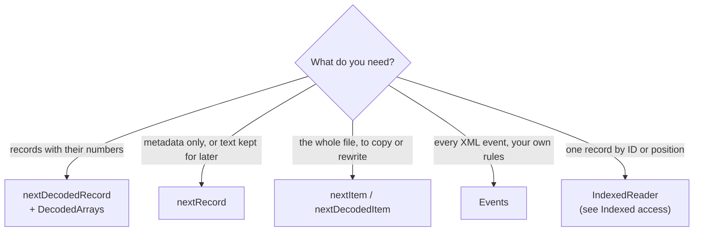

# Reading

zmz reads mzML forward, in one pass, holding only the current record. This page covers the four ways to do that and how to pick one.



If you are not sure, start with `nextDecodedRecord`. It is what most programs want.

## The reading loop

Every reader starts the same way: an allocator, a `std.Io.Reader`, and options.

```zig
var reader = try mzml.StreamReader.init(allocator, &input.interface, .{});
defer reader.deinit();
const header = try reader.readHeader();
std.debug.print("{d} parameter groups\n", .{header.groups.len});
while (try reader.nextRecord()) |record| {
    // `record` is valid until the next call.
    std.debug.print("{s}: {d} arrays\n", .{ record.id, record.binaryArrays().len });
}
```

- `readHeader` reads everything before the first spectrum and stops at the first list, without parsing a record. Calling it again returns the same header; its storage lasts until `deinit`.
- `nextRecord` returns one spectrum or chromatogram when its closing tag is read, without looking at the next one. It returns null at the end of the document.
- The previous record is invalid after the next call, even when that call fails or returns null.

The header gives you `header.groups` (the shared parameter groups records refer to), `header.cvDeclarations(allocator)` for the [vocabulary](Vocabulary), and the list descriptors with their declared and observed counts.

> [!IMPORTANT]
> zmz follows the records that are actually in the file. A declared count (`count="4536"`) is kept as source data next to the observed count, never trusted: a file whose count is wrong still reads every record it holds.

## Decoding while reading

`nextDecodedRecord` reads a record and decodes its arrays into a `DecodedArrays` you reuse for the whole file:

```zig
var arrays = mzml.DecodedArrays.init(allocator, .{});
defer arrays.deinit();
while (try reader.nextDecodedRecord(&arrays)) |record| {
    for (0..arrays.len()) |position| {
        const array = arrays.get(position).?;
        switch (array.values) {
            inline else => |values| std.debug.print("{s}: {d} values\n", .{ record.id, values.len }),
        }
    }
}
```

Each decoded array carries:

- `values`: a union of typed slices (`float32`, `float64`, `int32`, `int64`). MS-Numpress arrays decode to `float64`.
- `role`: `.mz`, `.intensity`, `.time`, or `.other`, from its array-type term, also when the term comes from a group.
- `encoding`: what the file declared.
- `source_position`: its index in `record.binaryArrays()`, where its metadata lives.

Each array decodes as its text streams in: plain arrays go straight from Base64 into the typed output, and compressed or Numpress arrays pass through a fixed 64 KiB window. No buffer ever holds a payload whole, so memory follows the number of values, not the size of the text. Results appear only once the whole record has decoded. The numbers live in `arrays` until its next use; see [Ownership and lifetimes](Ownership-and-lifetimes#decoded-numbers).

## Choosing what to decode

Decoding everything is wasteful when you want one array, or only MS1 spectra. An **array selector** decides, per array and per record, before any binary text is read:

```zig
fn ms1MzArrays(allocator: std.mem.Allocator, input: *std.Io.Reader) !void {
    var reader = try mzml.StreamReader.init(allocator, input, .{
        .array_selector = .{ .select = onlyMz, .select_record = onlyMs1 },
    });
    defer reader.deinit();
    _ = try reader.readHeader();

    var arrays = mzml.DecodedArrays.init(allocator, .{});
    defer arrays.deinit();
    while (try reader.nextDecodedRecord(&arrays)) |record| {
        const mz = arrays.get(0) orelse continue; // not MS1: nothing was decoded
        switch (mz.values) {
            inline else => |values| std.debug.print("{s}: {d} m/z values\n", .{ record.id, values.len }),
        }
    }
}

fn onlyMs1(_: ?*anyopaque, view: mzml.StreamReader.Selection) mzml.model.MetadataError!mzml.StreamReader.Payload {
    if (view.node.kind != .spectrum) return .skip;
    const level = try view.node.integer(i32, view.groups, mzml.model.Terms.MS_LEVEL);
    return if (level == 1) .retain else .skip;
}

fn onlyMz(_: ?*anyopaque, view: mzml.StreamReader.Selection) mzml.model.MetadataError!mzml.StreamReader.Payload {
    const role = try view.node.parameter(view.groups, mzml.model.Terms.MZ_ARRAY);
    return if (role != null) .retain else .skip;
}
```

- `select_record` runs once per record, before its array list, with the record's attributes and the parameters read so far. `.skip` skips every array of the record; the record itself is still returned.
- `select` runs once per array, after its leading parameters and before its binary text.
- `user_data` (null here) passes your own state to both.

Skipped arrays keep their metadata; only their numbers are not produced. A record with nothing selected comes back with `arrays.len() == 0`; it is not the end of the file.

> [!WARNING]
> Callbacks see only what has been read so far. A parameter written after the array list, or after the binary element, is not visible to them. When a decision needs a record's complete metadata, read without a selector, with `nextRecord` (which keeps the binary text), and decode afterwards with `arrays.decodeRecord(record, header.groups)`.

## Metadata only

When you need no numbers at all, skip the binary text entirely:

```zig
var reader = try mzml.StreamReader.init(allocator, &input.interface, .{ .payload = .skip });
```

Arrays keep their declarations; their text is dropped as it is read. With the default, `.payload = .retain`, `nextRecord` keeps each array's Base64 text so you can decode it later or write it back unchanged.

## Copying a file

`nextRecord` returns records only. A file also holds XML between and after them: list attributes, run metadata after the lists, unfamiliar elements. To copy or rewrite a whole file, read **items**:

```zig
fn copy(allocator: std.mem.Allocator, input: *std.Io.Reader, sink: *std.Io.Writer) !void {
    var reader = try mzml.StreamReader.init(allocator, input, .{});
    defer reader.deinit();
    var writer = try mzml.Writer.init(allocator, sink, .{});
    defer writer.deinit();

    try writer.writeHeader((try reader.readHeader()).*);
    while (try reader.nextItem()) |item| try writer.writeItem(item);
    try writer.finish();
    try sink.flush();
}
```

Items come in source order: `.list_start`, `.record`, `.xml`, `.list_end`, and `.run_end`. `nextDecodedItem` does the same while decoding the records' arrays. [Writing](Writing#rewriting-a-file) shows how to change records on the way.

> [!CAUTION]
> Do not mix `nextRecord` into an item loop: it skips the XML between records, and the copy loses it.

## Raw XML events

`Events` is for programs that interpret the document themselves, like a validator. It checks XML well-formedness and nothing about mzML, and returns start, end, and text events with their source byte offsets:

```zig
fn countSpectra(allocator: std.mem.Allocator, input: *std.Io.Reader) !usize {
    var events = try mzml.Events.init(allocator, input, .{ .skip_whitespace_text = true });
    defer events.deinit();
    var spectra: usize = 0;
    while (try events.next()) |event| switch (event.data) {
        .start_element => |start| {
            if (mzml.Events.kindOf(start.name) == .spectrum) spectra += 1;
        },
        else => {},
    };
    return spectra;
}
```

- `event.span` gives the start and end byte offsets in the source, also for UTF-16 input.
- Text arrives in runs of at most 64 KiB, with references resolved; CDATA arrives as text.
- `Events.kindOf(name)` and `model.encodingTerm(accession)` use the readers' own tables, so an event program agrees with the readers on what an element or term means.
- `DecodedArrays.decodeArrayText` decodes an array from the text runs you collect, with the readers' rules.

Each event's slices last until the next call. Keep what you need in a buffer you reuse, not a heap copy per event: one small allocation per parameter can cost more than the parsing.

## Input the reader accepts

- XML 1.0 in UTF-8, UTF-16 (either byte order), or declared ISO-8859-1; text comes back as UTF-8, offsets count source bytes.
- mzML 1.1 and the original 1.0, each read as written; see [Versions and compatibility](Versions-and-compatibility).
- Elements and attributes zmz does not model are kept as XML, so copying preserves them.
- DTDs and external entities are rejected.

What the reader refuses, and why, is in [Errors and diagnostics](Errors-and-diagnostics) and [Limits and safety](Limits-and-safety).
