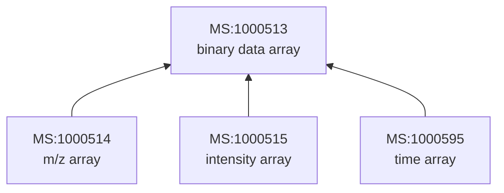

# Vocabulary

mzML puts its meaning in controlled-vocabulary terms: `MS:1000511` is "ms level", `UO:0000031` is "minute". zmz bundles the two vocabularies mzML uses, PSI-MS and the Unit Ontology, and `cv.Resolver` checks a file's parameters against them.

All of this is optional. Reading, writing, and decoding never touch the tables, and a program that does not call them does not link them.

## What gets bundled

- **PSI-MS 4.2.5** (`psi-ms-core.obo`): 4,154 terms, with the release history back to 3.80.0_rc1 (December 2015).
- **Unit Ontology, release 2026-10-12**: 574 terms, with releases back to March 2011.

Both ship as generated Zig tables that compile into your program; nothing is downloaded or read at run time. The tables are split by use, so lookup alone adds about 0.2 MB to a stripped binary, resolution about 0.4 MB, and every definition and synonym about 1 MB. A weekly workflow in the repository proposes an update when either vocabulary has a new release.

## Checking a file's parameters

The resolver reads the file's `cvList` declarations, so it knows what `cvRef="MS"` means in this file, then looks every parameter up:

```zig
fn checkParameters(allocator: std.mem.Allocator, header: *const mzml.model.Header, record: mzml.model.Record) !void {
    const declarations = try header.cvDeclarations(allocator);
    defer allocator.free(declarations);
    const resolver = mzml.cv.Resolver.init(declarations);

    for (record.node.params) |entry| {
        if (entry != .cv) continue;
        const result = try resolver.resolve(entry.cv);
        const match = result.term.match orelse {
            std.debug.print("unknown term {?s}\n", .{entry.cv.name});
            continue;
        };
        if (result.term.issues.stale_name)
            std.debug.print("{s}: the file says {?s}, the vocabulary {s}\n", .{ match.term.id(), entry.cv.name, match.term.name() });
        if (result.term.issues.obsolete) std.debug.print("{s} is obsolete\n", .{match.term.id()});
    }
}
```

`resolve` never changes the parameter; `result.source` is exactly what the file said. Next to it, the result reports separately on the term and on its unit:

- **`match`**: the vocabulary term, or null when the accession is unknown.
- **`version`**: how the declared version relates to the bundled one: `exact`, `historical` (an older release the history records), `future`, or `unrecognized_version`, among others.
- **`issues`**: independent flags. A term can be found and still have several.

The flags worth knowing:

- `stale_name`: the file's name differs from the current one. With `former_name` also set, it was the right name in an older release ("Q-Tof ultima" for `MS:1000189`, for instance).
- `obsolete`: the term is retired. `Term.replacedBy` and `Term.consider` say what to use instead.
- `unknown_accession`, `missing_accession`, `missing_declaration`: the reference itself is broken.
- `namespace_mismatch`: a `UO:` accession under `cvRef="MS"`, for example.

How far to go from there is your choice. A viewer might show a warning; a pipeline might stop. The resolver only reports.

> [!NOTE]
> Duplicate declaration IDs and ambiguous resources are errors from `resolve`, not flags, because no single answer would be right.

## Numbers with units

`resolver.quantity(T, parameter)` parses a parameter's value and resolves its unit in one step:

```zig
fn scanTimes(resolver: mzml.cv.Resolver, record: mzml.model.Record, groups: []const mzml.cv.Group) !void {
    for (record.scans()) |scan| {
        const time = try scan.scanStartTime(groups) orelse continue;
        const quantity = try resolver.quantity(f64, time.parameter);
        const unit = quantity.parameter.unit.match orelse continue; // no unit, or an unknown one
        if (quantity.parameter.unit_allowed == .disallowed) continue; // not a unit of time
        std.debug.print("{d} {s} ({s})\n", .{ quantity.value, unit.term.name(), unit.term.id() });
    }
}
```

```text
0.0051 minute (UO:0000031)
```

- `unit_allowed` checks the term's `has_units` relations: `allowed`, `disallowed`, `not_declared` (the vocabulary lists no units for this term, which is not a prohibition), or `unresolved`.
- The value is never converted. Turning minutes into seconds is a decision your program makes, with the unit in hand.

## Walking the ontology

Each bundled resource is a `cv.Vocabulary`. `Resolver.BUNDLED[0]` is PSI-MS, `[1]` the Unit Ontology:

```zig
fn ancestry() !void {
    const ms = &mzml.cv.Resolver.BUNDLED[0];
    // An m/z array is a binary data array.
    std.debug.assert(try ms.isA("MS:1000514", "MS:1000513"));
    const term = ms.lookup("MS:1000514").?.term;
    std.debug.print("{s}: {s}\n", .{ term.id(), term.name() });
}
```

```text
MS:1000514: m/z array
```

`isA` answers from a precomputed ancestor closure, so it is a binary search at any depth. A `Term` also gives its `definition`, `synonyms`, `xrefs`, `parents`, `ancestors`, `subsets`, `relationships`, `alternateIds`, `firstRelease`, `obsoleteSince`, and `formerNames`. None of these allocate.



## A newer release at run time

PSI-MS releases several times a year. To use a release newer than the one zmz was built with, or the full `psi-ms.obo` with its column models, parse it at run time with `cv.Vocabulary.parseObo` and hand the result to a `Resolver` in place of the bundled PSI-MS. The [vocabulary README](https://github.com/eneskemalergin/zmz/blob/main/vocabularies/README.md#newer-releases-at-run-time) has the full example.

## Checking real files

```sh
zig build vocabulary -Doptimize=ReleaseFast -- scan FILE.mzML [FILE.mzML ...]
```

`scan` reads each file through and reports every unknown, obsolete, or stale term and unit it finds, counted per physical occurrence. It is a quick way to see how well a producer's files follow the vocabulary.
