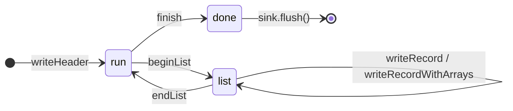
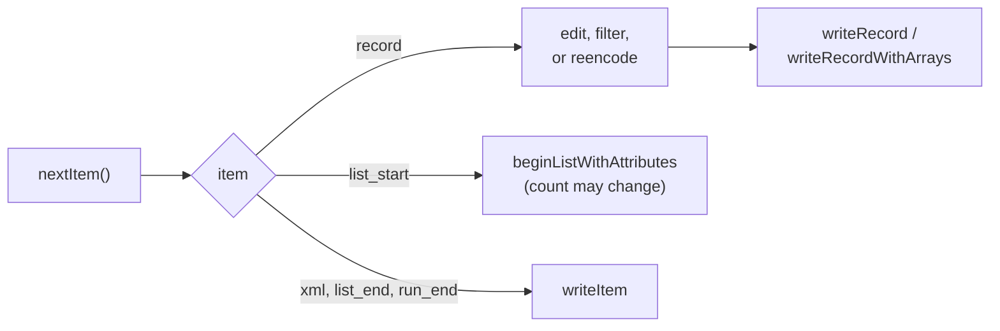

# Writing

`Writer` writes mzML forward, one call per part, without keeping records or the run in memory. `Builder` makes the parts when they do not come from a file you read.

## The order of calls

The writer enforces the document's shape. Calls out of order return `InvalidState`.



- At most one spectrum list and one chromatogram list, spectra first.
- `writeItem` accepts everything a [forward read](Reading#copying-a-file) returns, so it covers all of these in one call.
- `finish` closes the run and the document, and writes the index for indexed output. It does not flush your sink: do that yourself, then close it.
- `deinit` does neither. A writer dropped before `finish` leaves an incomplete document.

## Three kinds of output

- **`Writer.init(allocator, sink, limits)`** writes plain mzML to any `std.Io.Writer`: a file, a socket, a buffer, a pipe.
- **`Writer.initIndexed(allocator, sink, limits, index_options)`** writes indexedmzML: it remembers each record's ID and offset, appends the index, and computes the SHA-1 checksum while writing.
- **`Writer.initFile(allocator, &file_writer, limits, index_options)`** writes to a positional file writer at offset zero, and can go back and patch what it did not know up front. Pass `null` index options for plain mzML.

A forward-only sink cannot take anything back, so with `init` and `initIndexed` each list needs its exact record count when it opens, and a wrong count is `CountMismatch`. With `initFile`, the count may be `null`: the writer leaves a fixed-width placeholder and fills it in at `endList`. That is what makes one-pass filtering possible.

## Building a document

This writes a complete indexed document with one spectrum. First, the smallest header that makes a valid file:

```zig
fn makeHeader(builder: *mzml.Builder) !mzml.model.Header {
    return builder.header(.{
        .document = .{
            .kind = .mzml,
            .attributes = &.{.{ .name = "version", .value = "1.1.0" }},
            .children = &.{
                try builder.list(.cv_list, &.{try builder.cvDeclaration(.{
                    .id = "MS",
                    .full_name = "Proteomics Standards Initiative Mass Spectrometry Ontology",
                    .uri = "https://raw.githubusercontent.com/HUPO-PSI/psi-ms-CV/master/psi-ms.obo",
                })}),
                .{ .kind = .file_description, .children = &.{.{ .kind = .file_content }} },
                try builder.list(.software_list, &.{.{ .kind = .software, .attributes = &.{
                    .{ .name = "id", .value = "my-tool" },
                    .{ .name = "version", .value = "1.0" },
                } }}),
                try builder.list(.instrument_configuration_list, &.{.{
                    .kind = .instrument_configuration,
                    .attributes = &.{.{ .name = "id", .value = "instrument" }},
                }}),
                try builder.list(.data_processing_list, &.{.{
                    .kind = .data_processing,
                    .attributes = &.{.{ .name = "id", .value = "processing" }},
                    .children = &.{.{ .kind = .processing_method, .attributes = &.{
                        .{ .name = "order", .value = "0" },
                        .{ .name = "softwareRef", .value = "my-tool" },
                    } }},
                }}),
            },
        },
        .run = .{ .kind = .run, .attributes = &.{
            .{ .name = "id", .value = "run1" },
            .{ .name = "defaultInstrumentConfigurationRef", .value = "instrument" },
        } },
    });
}
```

Yes, it is long. mzML requires a vocabulary declaration, a file description, software, an instrument configuration, and a processing record, and zmz will not invent any of them for you. In a real program this metadata comes from your acquisition or from the file you are processing, and `builder.header(source)` copies it.

Then the record and its arrays:

```zig
fn writeExample(allocator: std.mem.Allocator, sink: *std.Io.Writer) !void {
    var writer = try mzml.Writer.initIndexed(allocator, sink, .{}, .{});
    defer writer.deinit();
    var builder = mzml.Builder.init(allocator, .{});
    defer builder.deinit();

    try writer.writeHeader(try makeHeader(&builder));
    builder.reset(); // the header is written; its storage can go

    var encoder = mzml.arrays.Encoder.init(allocator, .fast);
    defer encoder.deinit();
    const mz_values = [_]f64{ 100.0, 200.0, 300.0 };
    const intensity_values = [_]f32{ 10.0, 20.0, 30.0 };
    const mz = try builder.prepareArray(f64, &mz_values, .{
        .cv_ref = "MS",
        .role = .{ .cv_ref = "MS", .accession = mzml.model.Terms.MZ_ARRAY, .name = "m/z array" },
        .encoding = .{ .pipeline = .zlib },
    }, &encoder);
    const intensity = try builder.prepareArray(f32, &intensity_values, .{
        .cv_ref = "MS",
        .role = .{ .cv_ref = "MS", .accession = mzml.model.Terms.INTENSITY_ARRAY, .name = "intensity array" },
        .encoding = .{ .pipeline = .zlib },
    }, &encoder);
    const record = try builder.record(.spectrum, "scan=1", 0, mz_values.len, &.{.{ .cv = .{
        .cv_ref = "MS",
        .accession = mzml.model.Terms.MS_LEVEL,
        .name = "ms level",
        .value = "1",
    } }}, &.{}, &.{ mz.array, intensity.array });

    try writer.beginList(.spectrum_list, 1, "processing");
    try writer.writeRecordWithArrays(record.node, &.{ mz.payload, intensity.payload });
    try writer.endList();
    try writer.finish();
    try sink.flush();
}
```

A few things worth noticing:

- `prepareArray` encodes nothing. It returns the array's metadata (`mz.array`: data type, compression, role, and `arrayLength` where needed) and a payload that borrows your values. The writer encodes each array while writing it.
- The role and its unit are yours to state. zmz does not guess that an `f64` array is m/z.
- `builder.record` checks that every default array (m/z, intensity, time) has `defaultArrayLength` values, and sets `id`, `index`, and `defaultArrayLength` for you.
- `encodedLength` is computed from the text actually written, whatever the metadata says.
- One `Builder` can serve a whole file: `reset` it after each record is written. Never reset it, or the encoder, between preparing an array and writing its record.

## Rewriting a file

Reading items and writing them back gives a faithful copy: every attribute, parameter, and unfamiliar element, in source order. A rewrite is that loop with a change in the middle:



What each kind of change needs:

- **Filtering records** changes the list count, so use `initFile` with a `null` count in `beginListWithAttributes`, and give the surviving records consecutive `index` attributes: mzML requires them.
- **Editing metadata** means building a new `Node` from the record's node, with your own copies of the slices you change. Strings you leave alone can keep borrowing from the reader until the record is written.
- **Changing an encoding** means decoding the arrays (`nextDecodedItem`) and preparing them again with `prepareArrayFrom`, which keeps the array's other metadata. When arrays get their encoding from a shared parameter group, `Builder.reencoding` prepares the header with new group definitions first.

The repository's [rewrite.zig](https://github.com/eneskemalergin/zmz/blob/main/examples/rewrite.zig) does all three as one complete program: `--ms1` filters, `--replace-user-param` and `--remove-user-param` edit, and `--zlib` reencodes. Its [walkthrough](https://github.com/eneskemalergin/zmz/blob/main/examples/README.md#copy-filter-or-reencode) covers the edge cases.

> [!TIP]
> Records from `nextDecodedRecord` or `nextDecodedItem` carry no Base64 text, because it was decoded on the way. Write them with `writeRecordWithArrays`, giving every array a payload; `writeRecord` on such a record returns `PayloadNotRetained`. To replace only some arrays and keep the others' text as it was, read with `nextRecord` or `nextItem` and use `writeRecordWithSelectedArrays`.

## What the writer guarantees

- **Deterministic output.** The same calls produce the same bytes.
- **Well-formed XML.** Text and attribute values are escaped, names are checked, and the writer refuses structure that mzML does not allow (`InvalidStructure`).
- **Your version.** A header read from an mzML 1.0 file is written as mzML 1.0, in its own namespace; see [Versions and compatibility](Versions-and-compatibility).
- **No half-success.** The first failure is sticky: later calls return `FailedState`, `diagnostic()` says what went wrong, and the partial output is never a complete document. Delete it.

What the writer does not check is whether your metadata makes scientific sense. That is [mzValidate](https://github.com/eneskemalergin/mzValidate)'s job.
