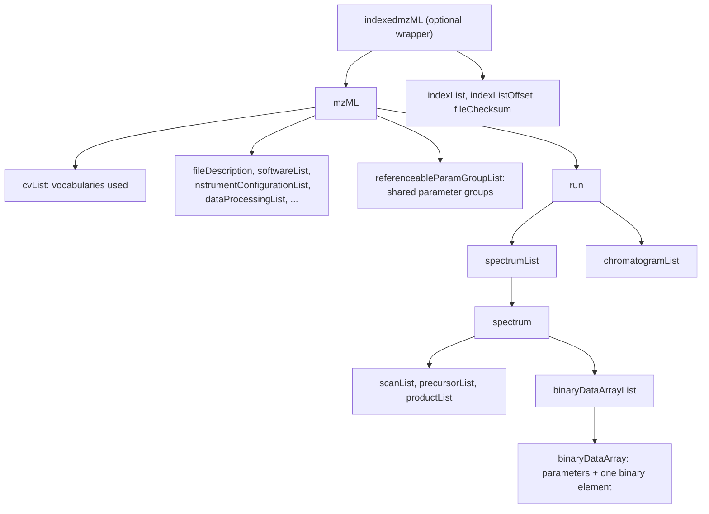

# mzML in brief

mzML is the HUPO Proteomics Standards Initiative's open XML format for mass-spectrometry data. This page explains just enough of it to read the rest of the wiki. The [specification](https://www.psidev.info/mzML) is the authority.

## The shape of a file

An mzML file is XML in two halves: a header that describes the experiment, then a run holding the measured spectra and chromatograms.



zmz calls everything before the first spectrum the **header**, and each spectrum or chromatogram a **record**. A record is the unit you read, look up, copy, and write.

## Parameters carry the meaning

mzML says almost nothing in element names. A spectrum is MS2, centroided, and positive-mode because of its **parameters**:

```xml
<spectrum id="scan=42" index="41" defaultArrayLength="512">
  <cvParam cvRef="MS" accession="MS:1000511" name="ms level" value="2"/>
  <cvParam cvRef="MS" accession="MS:1000127" name="centroid spectrum"/>
  <cvParam cvRef="MS" accession="MS:1000130" name="positive scan"/>
  ...
```

- A `cvParam` names a term from a controlled vocabulary by its **accession** (`MS:1000511`), with an optional value and unit. The accession is the identity; the name is a label for humans.
- A `userParam` is a free-form name and value for things no vocabulary covers.
- A `referenceableParamGroupRef` points at a shared group of parameters in the header, so a file can say "these arrays are all 64-bit zlib" once.

The vocabularies are [PSI-MS](https://github.com/HUPO-PSI/psi-ms-CV) for mass spectrometry and the [Unit Ontology](https://github.com/bio-ontology-research-group/unit-ontology) for units. [Metadata and parameters](Metadata-and-parameters) and [Vocabulary](Vocabulary) cover how zmz reads them.

## The numbers live in binary arrays

The peaks themselves are not XML numbers. Each array (m/z, intensity, time, and others) is a `binaryDataArray`: parameters that say what the array holds and how it is encoded, and a `binary` element with the encoded bytes as Base64 text.

```xml
<binaryDataArray encodedLength="5404">
  <cvParam cvRef="MS" accession="MS:1000523" name="64-bit float"/>
  <cvParam cvRef="MS" accession="MS:1000574" name="zlib compression"/>
  <cvParam cvRef="MS" accession="MS:1000514" name="m/z array" unitAccession="MS:1000040" unitName="m/z" unitCvRef="MS"/>
  <binary>eJwBAAj/9/...</binary>
</binaryDataArray>
```

The encoding is a pipeline: numbers, then optionally an MS-Numpress transform, then optionally zlib, then Base64. [Binary arrays](Binary-arrays) explains each step.

## Indexed mzML

A plain mzML file must be read from the start to find a spectrum. **indexedmzML** wraps the document and appends an index: the byte offset of every spectrum and chromatogram by ID, the offset of the index itself, and a SHA-1 checksum of the document. With it, a reader can jump straight to `scan=42`. [Indexed access](Indexed-access) covers both using an embedded index and rebuilding one.

## Versions

Two namespaces exist in practice: `http://psi.hupo.org/ms/mzml` for mzML 1.1 (1.1.0 and the 1.1.1 revision) and `http://psi.hupo.org/schema_revision/mzML_1.0.0` for the original 1.0. zmz reads and writes both and keeps each file in its own version. [Versions and compatibility](Versions-and-compatibility) has the details.
